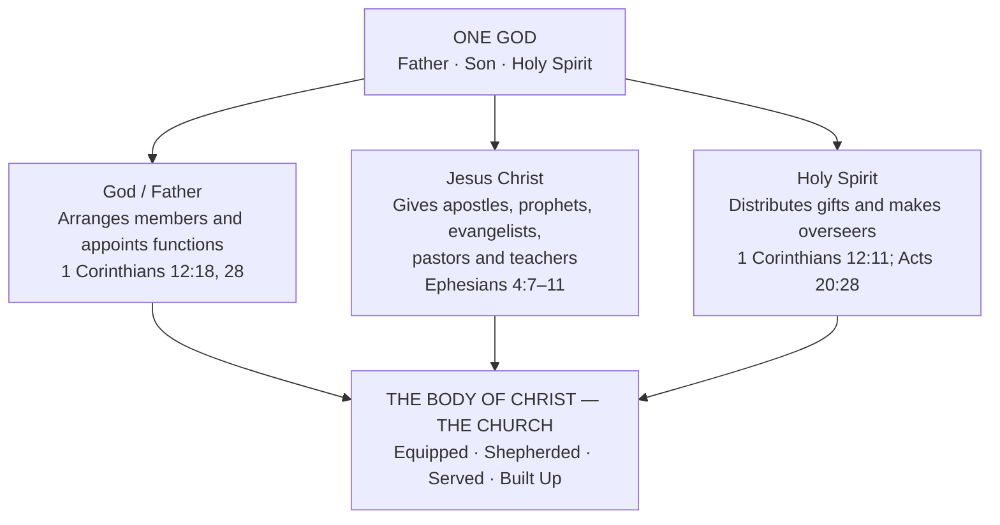
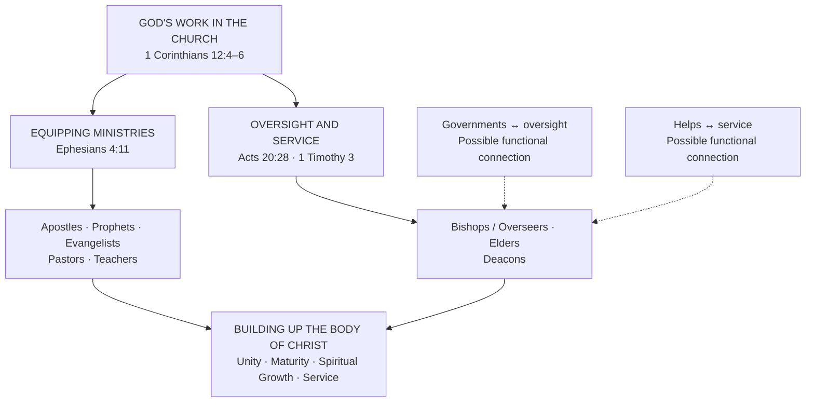
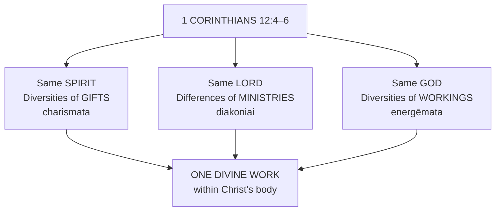

# Bishops, Deacons, the Fivefold Ministry, and God's Appointments in the Church

**October 17, 2026**

**Date:** October 17, 2026  
**Study type:** Personal Bible Study

**Primary Scriptures:** Ephesians 4:11–16; 1 Corinthians 12:4–31; Acts 20:17–28; 1 Timothy 3:1–13; Titus 1:5–9; Philippians 1:1.

**Additional Scriptures:** Acts 6:1–6; Acts 14:23; Romans 12:6–8; Romans 16:1–2; Ephesians 2:20; 1 Peter 5:1–4.

---

## 1. Purpose of the Study

The original purpose was to understand the biblical meaning of **bishops and deacons**, their responsibilities, qualifications, and whether their offices are established by God.

As the study progressed, seven questions emerged:

1. What do the original Greek words for bishop and deacon mean?
2. How are bishops, elders, and pastors related?
3. How do bishops and deacons differ from the fivefold ministry of Ephesians 4:11?
4. Are bishops and deacons appointed by God as the fivefold ministers are?
5. Why does Ephesians say Christ gives ministers while 1 Corinthians says God appoints them?
6. Are the apostles, prophets, and teachers in both passages the same ministries?
7. Could the **governments** of 1 Corinthians 12:28 correspond to bishops, and **helps** to deacons?

The study examines Scripture, Greek terminology, early Christian writings, and historical interpretations.

**Study principle:** Distinguish what Scripture explicitly states from reasonable interpretation and historical development. Confidence ratings describe strength of evidence, **not statistical probabilities**.

---

---

# Part I — Bishops and Deacons in Scripture

## 2. Original Greek Terminology

| Greek | Transliteration | Meaning | English |
|---|---|---|---|
| ἐπίσκοπος | Episkopos | Overseer, supervisor, guardian | Bishop, overseer |
| διάκονος | Diakonos | Servant, minister, agent | Deacon, minister, servant |
| πρεσβύτερος | Presbyteros | Elder, older person | Elder, presbyter |
| ποιμήν | Poimēn | Shepherd | Pastor |

These terms emphasize different aspects of ministry:

- **Bishop:** Oversight and responsibility.
- **Elder:** Maturity and recognized leadership.
- **Pastor:** Shepherding, feeding, and caring for God's people.
- **Deacon:** Service and ministry.

These distinctions do **not** necessarily indicate four separate offices.

## 3. Scriptures Referencing Bishops

### Acts 20:17–28

Paul summoned the **elders** of Ephesus (verse 17) and addressed these same men as **overseers** (verse 28).

> Take heed therefore unto yourselves, and to all the flock, over the which the Holy Ghost hath made you overseers, to feed the church of God, which he hath purchased with his own blood. — Acts 20:28, KJV

[Acts 20:28](https://bible.com/bible/1/ACT.20.28.KJV)

**Findings:**

- The men were identified as **elders** in verse 17.
- They were identified as **overseers** in verse 28.
- The **Holy Spirit** made them overseers.
- They were responsible for feeding and shepherding God's church.

The Greek word translated *overseers* is also translated *bishops* elsewhere. **Scripture directly attributes their appointment to the Holy Spirit.**

### Philippians 1:1

Paul addresses saints together with bishops and deacons, both in the plural. These are recognizable categories of ministry distinct from the wider congregation.

[Philippians 1:1](https://bible.com/bible/1/PHP.1.1.KJV)

### 1 Timothy 3:1–7

Qualifications for bishops include blamelessness, faithfulness in marriage, self-control, good behavior, hospitality, ability to teach, freedom from drunkenness, violence and greed, sound household management, maturity, and a good reputation outside the church.

[1 Timothy 3:1–7](https://bible.com/bible/1/1TI.3.KJV)

### Titus 1:5–9

Titus is to appoint elders in every city; Paul then immediately describes the qualifications of a bishop. This supports substantial overlap between the terms.

[Titus 1:5–9](https://bible.com/bible/1/TIT.1.KJV)

### 1 Peter 2:25

Jesus is called the Shepherd and Bishop of believers' souls.

[1 Peter 2:25](https://bible.com/bible/1/1PE.2.25.KJV)

**Related passages:** Acts 1:20 (*episkopē*, “bishoprick”); Acts 14:23; 15:2–23; 21:18; 1 Timothy 5:17–22; James 5:14; 1 Peter 5:1–4; Hebrews 13:17.

## 4. Scriptures Referencing Deacons

*Diakonos* has a broader meaning than the formal church title.

**Philippians 1:1:** Deacons are named alongside bishops.

**1 Timothy 3:8–13:** Deacons must be respectable, not double-tongued, not given to much wine, not greedy, holding the mystery of faith with a pure conscience, tested, blameless, and able to manage households. Unlike bishops, they are not explicitly required to be able to teach; this does not prohibit teaching.

[1 Timothy 3:8–13](https://bible.com/bible/1/1TI.3.KJV)

**Romans 16:1–2:** Phoebe is called a *diakonos* of the church at Cenchreae, translated “servant” in KJV. She certainly served or ministered; whether she held a formal deacon office remains debated.

[Romans 16:1–2](https://bible.com/bible/1/ROM.16.KJV)

**Other uses of diakonos:** Matthew 20:26; 23:11; Mark 9:35; 10:43; John 2:5,9; 12:26; Romans 13:4; 15:8; 1 Corinthians 3:5; 2 Corinthians 3:6; 6:4; Ephesians 3:7; 6:21; Colossians 1:7,23–25; 1 Timothy 4:6.

**Conclusion:** The context determines whether the word describes general service or a recognized church role.

## 5. Acts 6 and the Possible Origins of Deacons

Acts 6:1–6 concerns daily distribution to widows. Seven qualified men were selected.

> Wherefore, brethren, look ye out among you seven men of honest report, full of the Holy Ghost and wisdom, whom we may appoint over this business. — Acts 6:3, KJV

[Acts 6:3](https://bible.com/bible/1/ACT.6.3.KJV)

They needed good reputations, fullness of the Holy Spirit, wisdom, and responsibility. The apostles prayed and laid hands on them. **Acts 6 never explicitly calls these men deacons.** Stephen later preached (Acts 7), and Philip evangelized (Acts 8). Deacons should not automatically be limited to administrative or physical tasks.

---

# Part II — Bishops, Elders, and Pastors

## 6. Are Bishops and Elders the Same?

Acts 20:17,28 calls the same leaders elders and overseers. Titus 1:5–7 moves from appointing elders to qualifications for a bishop. These are strong indications of closely connected or overlapping roles.

## 7. Are Bishops Also Pastors?

*Poimēn* means shepherd. Acts 20:28 commands overseers to shepherd the church; 1 Peter 5:1–4 commands elders to shepherd and exercise oversight.

| Description | Emphasis |
|---|---|
| Elder | Maturity and leadership |
| Bishop | Oversight |
| Pastor | Shepherding and spiritual care |

These functions overlap substantially. A bishop may exercise pastoral ministry, but Scripture does not explicitly say every bishop possesses a distinct Ephesians 4:11 pastoral gift.

---

# Part III — The Fivefold Ministry

## 8. Ephesians 4:11–16

> And he gave some, apostles; and some, prophets; and some, evangelists; and some, pastors and teachers; — Ephesians 4:11, KJV

[Ephesians 4:11](https://bible.com/bible/1/EPH.4.11.KJV)

The five commonly identified ministries are apostle, prophet, evangelist, pastor, teacher. “Fivefold ministry” is a theological label, not an expression used in Scripture. Some interpreters closely connect pastors and teachers grammatically.

Ephesians 4:12–16 describes equipping saints, building the body, unity of faith, knowledge of the Son of God, spiritual maturity, protection from deception, and growth in love.

---

# Part IV — Comparing Ministries

## 9. Differences in Ministry

| Category | Fivefold ministry | Bishop | Deacon |
|---|---|---|---|
| Main text | Ephesians 4:11 | Acts 20:28; 1 Timothy 3 | 1 Timothy 3:8–13 |
| Divine involvement | Christ gives ministers | Holy Spirit makes overseers | Qualified and recognized service |
| Emphasis | Equipping the Church | Oversight and shepherding | Service and ministry |
| Teaching | Explicit for teachers | Required qualification | Not explicitly required |
| Oversight | Depends on ministry | Explicit | Not explicitly assigned |
| Scope | Local or broader | Congregational leadership | Church service |

The categories are not necessarily mutually exclusive.

## 10. Are Bishops Appointed by God?

**Yes.** Acts 20:28 explicitly says the Holy Spirit made overseers. Titus 1:5 describes human appointment of elders. These can work together: divine calling and human recognition, though Scripture does not specify every detail of their relationship.

## 11. Are Deacons Appointed by God?

Deacons are biblically recognized and spiritually qualified. No passage states as directly as Acts 20:28 that the Holy Spirit made particular individuals deacons. Acts 6 models qualified appointment without explicitly naming deacons. This does not exclude divine calling or spiritual direction.

---

# Part V — Christ Giving and God Appointing

## 12. The Question Raised

Ephesians 4:11 says Christ gave ministers, while 1 Corinthians 12:28 says God appointed ministries. Are these two groups?

> And God hath set some in the church, first apostles, secondarily prophets, thirdly teachers, after that miracles, then gifts of healings, helps, governments, diversities of tongues. — 1 Corinthians 12:28, KJV

[1 Corinthians 12:28](https://bible.com/bible/1/1CO.12.28.KJV)

## 13. Comparing Both Passages

| Ministry/gift | Ephesians 4:11 | 1 Corinthians 12:28 |
|---|---|---|
| Apostles | Yes | Yes |
| Prophets | Yes | Yes |
| Teachers | Yes | Yes |
| Evangelists | Yes | Not explicit |
| Pastors | Yes | Not explicit |
| Miracles | Not listed | Yes |
| Healings | Not listed | Yes |
| Helps | Not listed | Yes |
| Governments | Not listed | Yes |
| Tongues | Not listed | Yes |

**The apostles, prophets, and teachers in both passages are best understood as the same ministry categories**, with corresponding Greek terms. The lists are not identical because their emphasis differs:

- **Ephesians 4:11–16:** Christ gives ministers to equip the saints, mature believers, and build up His body.
- **1 Corinthians 12:27–31:** God arranges different members, gifts, and ministries within one body.

Neither list claims to be exhaustive. The absence of evangelists or pastors from Corinthians does **not** mean God did not appoint them.

## 14. Why Christ in One Passage and God in Another?

> Now there are diversities of gifts, but the same Spirit.
>
> And there are differences of administrations, but the same Lord.
>
> And there are diversities of operations, but it is the same God which worketh all in all. — 1 Corinthians 12:4–6, KJV

[1 Corinthians 12:4–6](https://bible.com/bible/1/1CO.12.KJV)

Paul describes three dimensions of divine activity:

| Reference | Divine person or designation | Activity |
|---|---|---|
| 1 Corinthians 12:4 | Spirit | Diversities of gifts |
| 1 Corinthians 12:5 | Lord | Differences of ministries or administrations |
| 1 Corinthians 12:6 | God | Diversities of workings or operations |

Within a **Trinitarian understanding**, these are compatible divine activities, not competing sources. Scripture does not suggest that Christ's giving and God's appointing describe rival systems.

> But now hath God set the members every one of them in the body, as it hath pleased him. — 1 Corinthians 12:18, KJV

[1 Corinthians 12:18](https://bible.com/bible/1/1CO.12.18.KJV)

---

# Part VI — Governments and Helps

## 15. The Meaning of Governments

The KJV “governments” translates *kybernēseis*, associated with steering, guidance and direction, like piloting a ship. It may refer to administration and leadership. Bishops oversee and guide congregations, so their functions plausibly overlap with governments. **Paul does not explicitly equate them.** *Episkopos* means overseer; *kybernēsis* means guidance or steering.

## 16. Personal Study Observation

> **Personal study observation:** I believe that **“governments” in 1 Corinthians 12:28 likely corresponds to the oversight and leadership responsibilities exercised by bishops.**

**Reasons supporting this interpretation:**

1. God appoints governments within the Church.
2. Acts 20:28 says the Holy Spirit makes overseers.
3. Bishops guide, shepherd and protect congregations.
4. Governments conveys steering or directing.
5. These functions substantially overlap.

**Qualification:** This remains an inference, not an explicit identification made by Paul.

**Helps** translates *antilēmpseis*, assistance or support. This may overlap with deacon ministry but is not explicitly equated with deacons.

- Governments — guidance, leadership and oversight.
- Helps — assistance and support.
- Bishops — recognized overseers.
- Deacons — recognized servants or ministers.

---

# Part VII — Order of Ministries

## 17. First Apostles, Second Prophets, Third Teachers

1 Corinthians 12:28 places apostles first, prophets second, teachers third. Some see a hierarchy of authority; others a priority or foundational function.

> And are built upon the foundation of the apostles and prophets, Jesus Christ himself being the chief corner stone; — Ephesians 2:20, KJV

[Ephesians 2:20](https://bible.com/bible/1/EPH.2.20.KJV)

Apostles and prophets have foundational significance, but 1 Corinthians 12 does not supply a complete church chain of command. Every member is necessary.

---

# Part VIII — Historical Evidence

## 18. Early Christian Writings

**Didache, chapter 15** (commonly dated late first or early second century): Communities are instructed to appoint qualified, humble, truthful bishops and deacons who do not love money.

**First Clement, chapters 42–44** (approximately AD 95–100): Connects bishops and deacons with apostolic appointments and continuity of leadership.

**Ignatius of Antioch** (approximately AD 110): Distinguishes bishop, presbyters/elders and deacons, showing a threefold structure in at least some communities.

**Historical qualification:** These writings show how church leadership was understood and organized in early Christianity. They do not prove that every congregation in the apostolic period followed the same structure. The New Testament itself provides stronger evidence of overlapping *elder* and *overseer* terminology than of a fully developed later episcopal hierarchy.

---

# Part IX — Interpretations and Confidence Ratings

## 19. Findings

| Interpretation | Confidence | Basis |
|---|---:|---|
| Bishop means overseer | 99% | Greek and NT usage |
| Deacon means servant/minister | 99% | Greek and broad usage |
| Bishops and elders substantially overlap | 95% | Acts 20; Titus 1 |
| Bishops exercise pastoral responsibility | 95% | Acts 20; 1 Peter 5 |
| Holy Spirit appoints overseers | 99% | Acts 20:28 |
| Deacons are recognized ministers | 98% | Philippians 1:1; 1 Timothy 3 |
| Deacons primarily handled charitable/practical needs | 75% | Acts 6 model, not full definition |
| Christ gives Ephesians 4:11 ministries | 99% | Explicit text |
| God appoints ministries in Church | 99% | 1 Corinthians 12:28 |
| Apostles, prophets, teachers are same categories in both lists | 99% | Matching Greek and context |
| Bishops and governments have overlapping leadership functions | 80% | Functional similarity, no direct equation |
| Helps may correspond to deacon ministry | 70% | Functional similarity, no direct equation |
| NT establishes fully developed later diocesan bishop structure | 15% | Later structure exceeds explicit NT evidence |

The 80% and 70% ratings are interpretive judgments, not direct scriptural identifications or statistical probabilities.

---

# Part X — Overall Conclusions

## 20. What Has Been Established?

1. **Christ gives ministries:** Ephesians 4:11 names apostles, prophets, evangelists, pastors and teachers to equip and build the Church.
2. **God appoints functions:** 1 Corinthians 12:18,28 describes God's arrangement of members and ministries, including helps and governments.
3. **Holy Spirit makes overseers:** Acts 20:28 directly attributes overseer appointment to the Spirit.
4. **Bishops, elders and pastors overlap:** Leadership, oversight and shepherding are closely related.
5. **Deacons are qualified ministers:** Philippians 1:1 and 1 Timothy 3:8–13 establish recognized service, not an explicit Ephesians 4:11 category.
6. **Governments may overlap with bishops:** Guiding and overseeing functions are compatible, without explicit equivalence.
7. **Helps may overlap with deacons:** Supporting and serving functions are compatible, without explicit equivalence.
8. **Divine appointment and human recognition can cooperate:** Acts 20:28 and Titus 1:5 describe different aspects.

## 21. Final Summary

The study began with bishops and deacons and expanded to divine appointment and church ministries.

**Ephesians 4:11:** Christ gives ministers to equip His Church.

**1 Corinthians 12:28:** God appoints ministries and functions within His Church.

**Acts 20:28:** The Holy Spirit makes overseers.

These descriptions are compatible within Trinitarian understanding. Apostles, prophets and teachers in Ephesians and Corinthians are best understood as the same categories viewed from different perspectives. Bishops, elders and pastors have overlapping functions; deacons are spiritually qualified, recognized servants. Governments and helps **may** correspond to the governing and serving functions of bishops and deacons, respectively, but this remains interpretive.

**The strongest conclusion:** God gives gifts, appoints ministries and establishes responsibilities for building up Christ's body. Distinguish explicit Scripture from Greek linguistic support and reasonable inference.

---

# Part XI — References for Continued Study

## Primary Scriptures

- [Ephesians 4:7–16](https://bible.com/bible/1/EPH.4.KJV)
- [1 Corinthians 12:4–31](https://bible.com/bible/1/1CO.12.KJV)
- [Acts 20:17–28](https://bible.com/bible/1/ACT.20.KJV)
- [1 Timothy 3:1–13](https://bible.com/bible/1/1TI.3.KJV)
- [Titus 1:5–9](https://bible.com/bible/1/TIT.1.KJV)
- [Philippians 1:1](https://bible.com/bible/1/PHP.1.1.KJV)
- [Acts 6:1–8](https://bible.com/bible/1/ACT.6.KJV)
- [Romans 12:6–8](https://bible.com/bible/1/ROM.12.KJV)
- [Romans 16:1–2](https://bible.com/bible/1/ROM.16.KJV)
- [1 Peter 5:1–4](https://bible.com/bible/1/1PE.5.KJV)
- [Ephesians 2:20](https://bible.com/bible/1/EPH.2.20.KJV)

## Greek Language Resources

- [Mounce — Episkopos](https://www.billmounce.com/greek-dictionary/episkopos)
- [Strong's 1249 — Diakonos](https://biblehub.com/greek/1249.htm)
- [Strong's 2941 — Kybernēsis](https://biblehub.com/greek/2941.htm)
- [Strong's 484 — Antilēmpsis](https://biblehub.com/greek/484.htm)
- [Strong's 4166 — Poimēn](https://biblehub.com/greek/4166.htm)

## Historical and Academic Resources

- [Didache, Chapter 15](https://getgnosis.app/read/didache/15/)
- [First Clement, Chapters 42–44](https://www.newadvent.org/fathers/1010.htm)
- [Ignatius — Epistle to the Magnesians](https://www.newadvent.org/fathers/0105.htm)
- [St Andrews Encyclopaedia — Ordained Ministries](https://www.saet.ac.uk/Christianity/OrdainedMinistries)
- [International Theological Commission — The Diaconate](https://www.vatican.va/roman_curia/congregations/cfaith/cti_documents/rc_con_cfaith_pro_05072004_diaconate_en.html)

## 22. Questions for Future Study

1. Does *kybernēseis* refer specifically to church oversight or more broadly to spiritual guidance and administration?
2. Did early Christians explicitly identify governments with bishops?
3. Is helps directly related to deacon ministry?
4. How did bishop and elder become distinguished after the apostolic period?
5. Does Scripture distinguish receiving a ministry gift from appointment to an office?
6. How do Father, Son and Holy Spirit work together in calling, gifting and appointing ministers?

## Follow-up Research Action Items

- [ ] Research the six questions for future study.
- [ ] Compare early Christian interpretations of governments and helps.
- [ ] Continue distinguishing explicit teaching from inference.

---

# Part XII — The Trinity's Roles in Appointing, Gifting, and Establishing Ministries

These three diagrams summarize the relationships examined in this study. **They depict coordinated divine activity, not a hierarchy of divinity or a claim that each divine Person acts exclusively in one category.** In particular, 1 Corinthians 12:28 uses “God” without explicitly saying “the Father alone.”

## Diagram 1 — The Trinity and Ministry Appointments

**How to read this:** The Father, Son and Holy Spirit are not ranked in power or deity. The three branches identify activities highlighted by the passages, not exclusive job descriptions. Ephesians 4:11 directly names Christ as giver; Acts 20:28 directly names the Holy Spirit as the one who made overseers; 1 Corinthians 12:18,28 says God sets members and ministries in the Church. Calling the latter activity exclusively the Father's is an interpretive Trinitarian framing, not the verse's explicit wording.

## Diagram 2 — How God-Appointed Ministries Relate Within the Church

**How to read this:** The two branches are *not* a strict chain of command or mutually exclusive categories. Pastors, elders and overseers may overlap. “Governments” (*kybernēseis*) and “helps” (*antilēmpseis*) may describe functions associated with bishops and deacons, respectively, but Paul does not explicitly equate the terms. The dotted arrows denote **interpretive connections**, not established identities.

## Diagram 3 — The Coordinated Activity of the Trinity in 1 Corinthians 12:4–6

**How to read this:** The Greek words are *charismata* (gifts), *diakoniai* (ministries or services), and *energēmata* (workings or activities). In its Trinitarian reading, “Spirit,” “Lord,” and “God” highlight the Holy Spirit, Jesus Christ, and God the Father, respectively. The passage emphasizes unity amid diversity; it does **not** restrict any divine Person to only one kind of work.

**Study conclusion:** Ephesians 4:11, 1 Corinthians 12:4–28, and Acts 20:28 are compatible accounts of how God gifts, appoints, equips, and shepherds His Church. The diagrams distinguish direct textual statements from interpretive connections.
